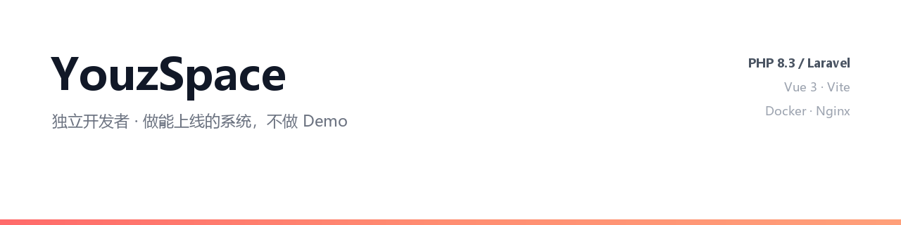

---

# YouzSpace

独立开发者，做能上线的系统。

主栈 PHP（Laravel）+ Vue 3。Java 写过 Swing + JDBC 的桌面应用，Spring Boot 在补。习惯把一件事从数据库设计、接口、前端做到 Docker 部署和线上运维，一个人完成闭环。

不做 Demo，交付的是能长期跑、能升级、出问题能定位的东西。

---

## 项目

### ControlHub / [3xui-hub](https://github.com/YouzSpace/3xui-hub)

多租户订阅与计费管理系统。用户、套餐、订单、流量统计、订阅链接导出（Clash / Sing-box / Base64）、异步任务队列与失败重试、面板 API 集成、一键安装脚本与 Docker 部署。

`PHP 8.3` `Laravel 13` `Vue 3` `MySQL` `Docker` `Nginx`

### [ip-probe](https://github.com/YouzSpace/ip-probe)

轻量 IP 探针。纯 PHP + JSON 文件存储，无需数据库即可部署，支持 WebRTC 内网地址探测与公网信息采集。

`PHP` `JSON` `零依赖部署`

### [NYCK--](https://github.com/YouzSpace/NYCK--)

短链接管理系统。纯 PHP + 文件存储，不依赖数据库，适合低配机器和小规模自建。

`PHP` `文件存储`

### [Dynamic-QR-Management-System](https://github.com/YouzSpace/Dynamic-QR-Management-System)

微信活码管理。固定链接的二维码可以随时换内容，支持可视化编辑、5 种主题 3 套模板、历史回滚、PV 统计。纯 PHP 实现，不需要数据库，上传即用。

`PHP` `JSON 文件存储`

---

## 技术栈

| 层 | 使用 |
|---|---|
| 后端 | PHP 8.3 / Laravel 13；Java（Swing + JDBC） |
| 前端 | Vue 3、Vite、Tailwind CSS、Pinia |
| 数据 | MySQL、JSON 文件存储 |
| 部署 | Docker、Nginx、Linux、systemd、队列守护 |
| 集成 | 第三方 API 对接、支付网关、Ed25519 签名（sodium） |

---

## 工作方式

- 需求先落到数据模型，再谈接口和界面
- 能不加依赖就不加，小项目优先零依赖部署
- 异步和重试是默认设计，不让前端等慢操作
- 交付包含部署脚本和升级路径，不丢给使用者一堆手工步骤

---

## 联系

- 站点：[app.zes.one](https://app.zes.one) · [store.zes.one](https://store.zes.one)
- 接受系统开发、后端接口、部署运维类合作
